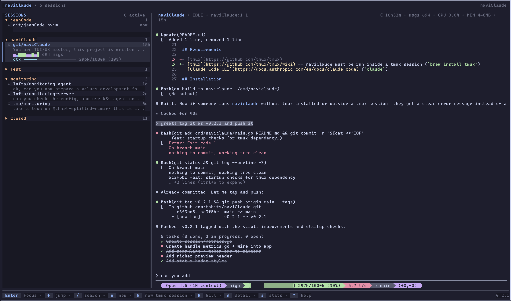

# naviClaude

TUI for managing Claude Code sessions across tmux sessions.

Like [cmux](https://github.com/manaflow-ai/cmux) or [herdr](https://github.com/herdrdev/herdr), but "bring your own tmux" --
it layers on top of your existing tmux setup instead of replacing it.



## Features

### Session list

- **Session sidebar** -- lists active and recently closed Claude Code sessions, grouped by tmux session. Each row shows the session's name (your rename, else Claude's own session title, else its slug), how long ago it was last active, and its first prompt as a summary. Scripted runs (`claude -p`, the SDK) that inherit a session's pane are not listed
- **Native status detection** -- reads Claude Code's own status file (`~/.claude/sessions/<pid>.json`) for working / waiting / idle and what a waiting session waits for; older Claude versions fall back to the pane's text, process CPU and recent transcript writes
- **Breathing status dots** -- active sessions pulse green (including ones whose subagents, background shells or Monitor watches are still running), waiting sessions pulse amber, a blue `◉` marks a session that finished while you were away
- **Live activity line** -- under the selected session, what Claude is doing right now: running subagents, background shells and Monitor watches first (`󰚩 2 agents ·  1 shell · 󰈈 1 monitor`, Nerd Font glyphs), then the tool in flight, its target and the turn time (`Bash · go test ./... · 42s`, or `󰧑 thinking` between tools); what it is waiting on you for (`needs approval: Edit`, `question: ...`, `plan approval`); or `✓ done 5m ago`
- **Background work on every row** -- sessions you are not on show the same `󰚩 2 agents ·  1 shell · 󰈈 1 monitor` counts under their summary while anything is still running, plus `󰧑 thinking` while the main thread is mid-turn
- **Workflow runs** -- running Workflow tool runs count as background work, so the session stays working while only a workflow is left: rows show ` 1 workflow (3 agents)`, and the selected session gets one line per run with its name, current phase and the agents running now (` native-arch-build-design · Review · review:infra, review:tests`)
- **Ultracode marker** -- a purple `󰉁` before the row's time marks a session running with ultracode on (`/effort ultracode`), detected from the transcript and cleared when it is turned off or the process restarts
- **Context usage bar** -- current token usage vs the context window (`ctx ━━━──── 62K/1M (6%)`), amber from 60% and red above 85%; the window size is inferred from the model id (1M for Claude 5 models, Fable, Opus and `[1m]` variants, 200K otherwise, bumped if usage already exceeds it)
- **Repo, branch and changes line** -- the session's git repo, branch and its edited files at a glance (` naviClaude ⎇ main ↑2↓1 · 3 files +120/−8`); `↑2↓1` is how many commits the branch is ahead of / behind its upstream as of your last fetch (naviClaude never fetches), left out when level, detached or without an upstream; the repo name is dropped when the pane is too narrow for both
- **Attention-first ordering** -- each group splits into pinned, waiting, done, working and idle sections (see [Sections](#sections)); pinned tmux sessions, then groups with a pinned session, then groups with a session waiting on you or done unseen sort to the top
- **Auto-collapse** -- a group collapses once all its sessions have been idle for `collapse_after_hours`, and the Closed group starts collapsed; groups you toggle yourself are left alone
- **Fuzzy search** -- filter by project name (the directory name, not a name you set with `r`), first prompt, directory, git branch or tmux session name, across every closed session still on disk (not just the last `closed_session_hours`)
- **Next-attention key** -- `Space` jumps to the next session waiting on you, then to the ones that finished unseen, and when there are none cycles the working ones, opening a collapsed group on the way
- **Status filters** -- `w` / `d` / `a` / `i` narrow the list to waiting, done, working or idle sessions, with a `filter: done` tag in the title bar
- **Scripting and agents** -- `naviclaude list`, `wait` and `send` read and drive sessions from scripts or other Claude sessions, and `naviclaude skill` prints a Claude Code skill that teaches them (see [Scripting](#scripting))
- **Status title bar** -- one row with live counts of sessions restoring / working / needing you / done / idle; the footer shows a few hints for the current mode and `? more` opens the help overlay

### Preview and details

- **Live preview** -- real-time tmux pane capture of the selected session. A closed session shows its last conversation turns (`You` / `Claude`) instead, and a group header shows a summary of its sessions (status counts, total CPU/memory, models, projects)
- **Preview search** -- `S` searches the text in the preview (a live pane with its tmux history, or a closed session's conversation), highlights every match and steps through them with `n` / `N`, showing a `3/17` counter
- **Rich preview header** -- project, branch, tmux target, status badge (including what a waiting session waits for), uptime, model (e.g. `Opus 5.5`), CPU/memory, and a red `cache expired` tag once the session has idled past Claude's 1-hour prompt cache
- **Passthrough mode** -- type directly into a session without leaving the TUI
- **Changed-files sidebar** -- a right-hand panel listing the files the selected session edited, with per-file `+/-` counts (live `git diff` while uncommitted, a persistent transcript estimate afterwards, shown faint); open any file in your editor. Only the main thread's edits are listed, not subagents'
- **Detail popup** -- view session metadata (project, CWD, branch, status, session ID, tmux target, transcript file, slug, model, Claude Code version, start time / uptime, message count, and CPU/memory for live sessions)
- **Usage statistics** -- rebuilt from your Claude Code transcripts: sessions, prompts, output and total tokens (each API response counted once; cache reads/writes and subagents included), top projects, prompts per day (per hour for Today), model share and busiest hour, filtered by All time / This week / Today. It only covers transcripts Claude Code still keeps on disk; per-file summaries are cached in `naviclaude/transcript-stats.gob` under your user cache dir (`~/Library/Caches` on macOS) so reopening it is fast

### Managing sessions

- **Session management** -- create new sessions (from an fzf-style directory picker that searches the dirs under the current dir (6 levels) and your home dir (4 levels, hidden dirs skipped), plus your other sessions' dirs and, if installed, [zoxide](https://github.com/ajeetdsouza/zoxide) dirs; it uses fzf's matching algorithm and extended syntax: `'exact`, `^prefix`, `suffix$`, `!exclude`), kill existing ones after a `y` confirm, rename them, move them between tmux sessions, and resume closed sessions into any tmux session (or a brand-new one) via a target picker
- **Mouse support** -- click and double-click rows, drag sessions and groups to reorder or move windows between tmux sessions, right-click context menus, drag to copy preview text, right-click to paste into a session (see [Mouse](#mouse))
- **Restore after restart** -- after a reboot or tmux restart, the first launch resumes the sessions that were running, back in the same pane when tmux-resurrect restored it (see [Restore after restart](#restore-after-restart))
- **Attention alerts** -- a sound, a colored bell / check after the tmux window name and an optional desktop banner (click it to land on that session) when Claude needs you or finishes, even while naviClaude is closed (see [Notifications](#notifications))

### Customization

- **11 built-in color themes** with a live theme picker, and an opt-in mode that follows the OS light / dark appearance (see [Themes](#themes))
- **Configurable key bindings** and layout options

## Requirements

- [tmux](https://github.com/tmux/tmux/wiki) 3.2 or newer -- naviClaude must be run inside a tmux session (`brew install tmux`). **tmux 3.8+ is recommended**: 3.7.x redraws popup borders on every status line or pane title redraw, so a popup blinks while Claude works, and 3.8 adds the floating panes naviClaude opens in (see [below](#run-as-a-floating-pane-tmux-38-recommended))
- [Claude Code CLI](https://docs.anthropic.com/en/docs/claude-code) (`claude`)
- For a manual install, [Go](https://go.dev/dl/) 1.26 or newer
- Alert sounds play only on macOS (via `afplay`); the window markers work everywhere
- Optional, for clickable desktop banners on macOS: [terminal-notifier](https://github.com/julienXX/terminal-notifier) (`brew install terminal-notifier`; the Homebrew formula installs it for you, see [Notifications](#notifications))

## Installation

### Homebrew

```
brew install thbits/tap/naviclaude
```

### Manual

```
git clone https://github.com/thbits/naviClaude.git
cd naviClaude
make install
```

This installs the binary to `~/.local/bin/naviclaude`. Set a custom prefix with `PREFIX=/usr/local make install`.

### Run as a floating pane (tmux 3.8+, recommended)

`naviclaude open` opens the dashboard over the current window: a **modal floating pane** on tmux 3.8 and newer, a `display-popup` on older tmux, so one binding works on every version. Add this to `~/.config/tmux/tmux.conf` to open it with `<prefix> g`:

```tmux
bind g run-shell -b 'naviclaude open -c "#{client_name}" -t "#{pane_id}"'
```

- `-b` runs the launcher in the background; `-c` / `-t` tell it which client and pane the key was pressed in (a `run-shell` job has neither of its own).
- `run-shell` uses the tmux server's `PATH`. If `naviclaude` is not on it, use the full path, e.g. `~/.local/bin/naviclaude open ...`.
- The pane is centered and sized by `popup_width` / `popup_height` (default 85% x 85% of the window).
- Pressing `<prefix> g` again while it is open does nothing. If the window already has some other modal pane, the launcher says so in the status line instead.
- Quit with `q`; jumping to a session (`f`) switches to it and closes naviClaude.
- Clicks outside the floating pane are ignored rather than closing it, `Esc` stays a naviClaude key, and the tmux prefix still works while it is open.
- Mouse support (click, wheel, menus) needs `set -g mouse on`.
- `naviclaude open -popup` forces the `display-popup` behaviour on tmux 3.8 too.

### Run as a tmux popup

`naviclaude open` already falls back to a popup on tmux 3.7 and older, so the binding above works as is. If you prefer a plain popup binding:

```tmux
bind g display-popup -E -w 85% -h 85% -x C -y C "naviclaude"
```

This binding sets its own size; `popup_width` / `popup_height` only apply to `naviclaude open`. tmux 3.8 gives popups a grey theme by default; naviClaude resets its own popup to your terminal's colours (when a single client is attached to the session), so no tmux.conf change is needed. You can also just run `naviclaude` in any tmux window or pane.

## Usage

Launch naviClaude from any terminal inside tmux:

```
naviclaude
```

Other commands:

```sh
naviclaude open [-c client] [-t pane] [-popup]   # open over the current window (floating pane or popup)
naviclaude focus <pane-or-session-id>            # show naviClaude with that session selected and focused (what a clicked banner runs)
naviclaude --select <pane-or-session-id>         # start with that session selected and focused (tmux pane id like %12, or a session id)
naviclaude hooks install | status | uninstall    # attention alerts (see Notifications); no argument = status
naviclaude notify test [request|done] [system|terminal]   # fire a sample desktop banner
naviclaude sound request | done                  # preview the alert sounds
naviclaude list [--json]                         # live sessions and their status (see Scripting)
naviclaude wait <target> --until <state>         # block until a session is waiting/working/idle/done
naviclaude send <target> <text...> [--wait]      # type a prompt into a session and submit it
naviclaude skill                                 # print the Claude Code skill for the commands above
naviclaude --version                             # or -v
```

The title bar shows live counts (`↻ 1 restoring · ● 2 working · ◎ 1 needs you · ◉ 1 done · ○ 3 idle`, zero counts left out, shortened to bare counts when narrow) and the current tmux session, plus a `filter: done` tag while a status filter is on. The footer lists the most useful keys for the current mode, dropping the less important ones when narrow, plus the version and `update available` when a newer release exists; `? more` opens the help overlay. Errors and notices briefly replace the hints.

### Key bindings

| Key | Action |
|---|---|
| `j` / `k`, `↑` / `↓` | Navigate sessions. Prefix a count to move that many sessions, e.g. `5j` (group headers are skipped; the pending count shows in the footer, `Backspace` drops its last digit and `Esc` cancels it) |
| `g` / `G` | Jump to the first / last row; `5g` or `5G` jumps to session 5 |
| `{` / `}` | Jump to the previous / next group header |
| `#` | Toggle row numbers (see `line_numbers`); the choice is saved to the config, unless `line_numbers_auto_hide` makes it a temporary show |
| `Tab` / `Shift+Tab` | Cycle focus across the visible panes (session list -> preview passthrough -> changed files). Inside passthrough `Tab` goes to the agent, so only `Shift+Tab` leaves |
| `Ctrl+]` | Exit passthrough straight to the session list |
| `Ctrl+U` / `Ctrl+D` | Scroll the preview half a page. A live Claude pane, which keeps its transcript out of tmux history, gets `PgUp` / `PgDn` instead and scrolls itself |
| `Space` | Jump to the next session that needs you: the ones waiting on you (a permission prompt or a question) in list order, then the ones done unseen, wrapping around. With none of either it cycles the working sessions. A collapsed group opens for its session, and visiting a done session marks it seen, so it leaves the cycle |
| `w` / `d` / `a` / `i` | Show only waiting / done / working (active) / idle sessions. One filter at a time; the same key again or `Esc` shows all. See [Status filters](#status-filters) |
| `/` | Search |
| `S` | Search the preview's text. See [Preview search](#preview-search) |
| `Enter` | Focus an active session (passthrough mode); on a closed session, open the resume picker; on a group header, collapse / expand it. Rebind with `focus` |
| `f` | Jump to pane. On a closed session, open the resume picker, then jump to the resumed pane |
| `Ctrl+F` | Jump to pane (from passthrough or search). In search, a closed result opens the resume picker, then jumps to the resumed pane |
| `n` | New session in the selected session's (or group's) tmux session, after picking its directory (the selected session's is preselected) |
| `N` | New tmux session: pick a directory (starting at `new_session_dir`), then name it |
| `r` | Rename session; on a group header, rename that tmux session |
| `m` | Move a live session's window to another tmux session (pick one, or type a new name to create it) |
| `p` | Pin a live session to the top of its group, whatever its status; on a group header, pin that tmux session to the top of the list (again to unpin) |
| `K` | Kill session (asks for `y`; any other key cancels) |
| `F` | Open the changed-files sidebar and focus it |
| `D` | Detail popup (any key closes) |
| `s` | Statistics popup (`Tab` cycles All time / This week / Today, any other key closes) |
| `T` | Theme picker: `j` / `k` preview themes live, `Enter` saves the theme to the config, `Esc` restores the previous one |
| `?` | Help overlay (any key closes) |
| `Esc` | Clear the preview search if one is on, else the status filter |
| `q` / `Ctrl+C` | Quit (in passthrough `Ctrl+C` goes to the session) |

In search:

| Key | Action |
|---|---|
| typing | Filter (`j`, `k` and the action keys type too) |
| `↑` / `↓`, `Ctrl+P` / `Ctrl+N` | Move through the results |
| `Enter` | Same as `Enter` in the list: focus an active result, open the resume picker for a closed one. `Esc` in the picker goes back to the search |
| `Ctrl+F` | Jump to the result's pane (resuming a closed one first) |
| `PgUp` / `PgDn` | Scroll the preview, e.g. a closed session's conversation |
| `Esc` | Leave search and restore the list |

In the preview search (`S`):

| Key | Action |
|---|---|
| typing | Search as you type, from where the preview stands (`j`, `k` and the action keys type too) |
| `↑` / `↓`, `Ctrl+P` / `Ctrl+N` | Previous / next match |
| `Enter` | Close the input and keep the matches highlighted; in the list `n` / `N` then go to the next / previous match |
| `Esc` | Clear the search and put the preview back where it was |

In the changed-files sidebar:

| Key | Action |
|---|---|
| `j` / `k`, `↑` / `↓`, `g` / `G` | Navigate files |
| `e` / `Enter` | Open the selected file in your editor |
| `F` | Close the sidebar |
| `Esc` | Back to the session list, keeping the sidebar open |
| `q` | Quit |

In pickers (resume target, move target, directory) type to filter, `↑` / `↓` or `Ctrl+P` / `Ctrl+N` to move, `Enter` to select and `Esc` to cancel; the directory picker also takes `→` / `Tab` to enter a directory and `←` for its parent. Context menus take `j` / `k` or the arrows, `Enter` and `Esc`.

The keys listed under `keys:` in the [config](#configuration) can be rebound, using Bubble Tea key names (`F`, `ctrl+x`, `enter`). Write the space bar as `space`. Navigation, `Enter` outside the session list, `Ctrl+U` / `Ctrl+D`, `T`, the preview search's `n` / `N` and the passthrough and menu keys (`Tab`, `Shift+Tab`, `Ctrl+]`, `Ctrl+F`, `Esc`, `Ctrl+C`) are fixed. A config error (naviClaude then runs on the defaults), or a key bound twice or to a reserved key, is reported in the status bar at startup.

The detail popup moved from `d` to `D` when `d` became the done filter. A config that still says `detail: "d"` (a saved config lists every key) is read as `D`; to keep detail on `d`, give `filter_done` another key.

### Status filters

`w`, `d`, `a` and `i` show only the sessions in one status, counted as the title bar counts them: waiting on you, done unseen, working (background subagents, shells, monitors and workflows included) or idle. Pinned sessions are filtered by their status like any other.

- Only matching rows show. Groups without a match and the Closed group are hidden, and matches inside a collapsed group are shown anyway; group headers count the matches.
- The title bar shows `filter: <status>`. The same key again, or `Esc`, shows everything again and keeps the selected session selected.
- The row under the cursor stays listed while you are on it, even after it stops matching (selecting a done session marks it seen). It leaves once you move on.
- `Space` cycles within the filtered rows only.
- Search (`/`) ignores the filter and lists every match; the filter is back when you leave the search. Opening a result the filter would hide, or starting a new session, clears the filter.

### Preview search

`S` opens a one-line query in the preview's header and searches what the preview holds right now: a live pane's screen and tmux history, a closed session's conversation turns, or a group summary. It is smart-case: an all-lower-case query ignores case, one with a capital letter matches exactly.

All matches are highlighted and the current one stands out; the preview scrolls to it and the header shows its position (`3/17`). `Enter` closes the input and keeps the matches: until you press `Esc`, `n` / `N` step to the next / previous match instead of starting a new session, and the footer says so. The search ends when you select another session or focus the pane.

A live Claude pane keeps its transcript out of tmux history, so only the text on its screen is searchable; scroll it (`Ctrl+U` / `Ctrl+D`) and the matches follow.

### Sections

Each tmux session group splits its rows into sections, top to bottom. When a group's rows span more than one section, each section is headed by a one-row line (`─ working ─────`):

| Section | Holds |
|---|---|
| pinned | Live sessions you pinned with `p`, whatever their status (marked with a pin) |
| waiting | Sessions waiting on you: a permission prompt or a question |
| done | Sessions that finished while you weren't looking, until you select them |
| working | Sessions working, including background subagents, shells, Monitor watches and Workflow runs |
| idle | Everything else |

A row moves to its section as its status changes. The sort order applies within pinned and working; waiting, done and idle list the most recent first, so a session that just finished lands on top. Dragging reorders a row within the pinned or working section.

Closed sessions sit in a separate Closed group: always last, collapsed until you open it, newest first, and not pinnable or draggable. Pins, pinned tmux sessions and the dragged group order are saved in `~/.config/naviclaude/view-state.json` and kept across restarts.

### Mouse

| Action | Effect |
|---|---|
| Hover a session | Highlight it |
| Click a session | Select it (and focus the session list) |
| Double-click a session | Same as `Enter`: focus an active session, open the resume picker for a closed one |
| Click a group header | Collapse / expand the group |
| Drag a live session | Drop it on another row to move its tmux window there, or on a group header to move it to the end of that tmux session (the group expands). Hold it at the top or bottom edge to scroll. Sets `session_sort_order` to `manual` |
| Drag a group header | Reorder the tmux session groups (pinned and attention groups still rank first). Sets `group_sort_order` to `manual` |
| Right-click a session | Open its [context menu](#context-menu) (also on search results; `Esc` returns to the search) |
| Right-click a group header | Rename the tmux session, start a new session in it, pin it to the top, or collapse / expand it |
| Long-press a session (hold ~450ms, then release) | Open the context menu -- for tmux setups whose `MouseDown3Pane` binding swallows right-click |
| Wheel over the session list | Move the selection up / down (in search, through the results; in passthrough, it first returns to the list) |
| Wheel over the preview / changed files | Scroll them. A live Claude pane gets the wheel itself and scrolls its own transcript |
| Click the preview / changed files | Focus that pane (the preview only for a live session) |
| Drag over the preview | Select text and copy it to the clipboard on release, then focus the preview if the session is live |
| Right-click the preview | Paste the clipboard's text into the live session (bracketed, as tmux pastes) and focus it |
| Drag the session list's right border | Resize the session list; the width is saved to `sidebar_width` on release |
| Click a hint in the bottom bar | Run that key |
| Click a menu item | Run it |
| Click a picker row | Select it (click the selected row again to confirm) |
| Click a filter tab in the statistics popup | Switch to that filter |
| Click outside a popup or menu | Close it (right-clicking another session row reopens the menu there) |
| Back / Forward mouse buttons | Step back through the sessions you recently clicked or focused (most recent first, each listed once, up to 50), and forward again. Back first returns to the last one if you moved the selection away from it with the keyboard; sessions that have gone are skipped |

Mouse events only reach naviClaude when tmux has `set -g mouse on`.

### Context menu

| Row | Items |
|---|---|
| Live session | Focus, Jump to pane, Detail, Set as unread (idle sessions), Pin to top / Unpin, Move to tmux session… (to another or a new one), Open in editor, Open in Finder / file manager, Copy session ID, Copy project path, Copy branch name, Kill session |
| Closed session | Resume, Resume & jump, Fork & Resume, Detail, Open in editor, Open in Finder / file manager, Copy session ID, Copy project path, Copy branch name, Copy resume command |
| Group header | Rename tmux session, New session here, Pin to top / Unpin, Collapse / Expand |

## Configuration

Config file location: `~/.config/naviclaude/config.yaml`

naviClaude creates this file when you save a theme, drag to reorder, resize the session list or toggle row numbers. It writes only the settings that changed, in place, so your comments, key order and keys it does not know survive, and it never overwrites a file that fails to parse (the status bar says so instead). All fields are optional -- missing fields use defaults, and so do zero, negative or invalid values (except `collapse_after_hours: 0`, which disables auto-collapse). A key naviClaude does not recognise (a typo such as `keys.detial`) is ignored but reported in the status bar on startup.

```yaml
keys:
  quit: "q"
  search: "/"
  focus: "enter"
  jump: "f"
  new_session: "n"
  new_tmux_session: "N"
  kill_session: "K"
  rename_session: "r"
  detail: "D"
  stats: "s"
  toggle_changed: "F"
  move_window: "m"
  pin_session: "p"
  toggle_line_numbers: "#"
  next_attention: "space"
  filter_waiting: "w"
  filter_done: "d"
  filter_working: "a"
  filter_idle: "i"
  preview_search: "S"
  help: "?"

sidebar_width: 30
refresh_interval: "200ms"
closed_session_hours: 8
group_sort_order: "name"
session_sort_order: "name"
line_numbers: "off"
line_numbers_auto_hide: "off"
popup_width: 85
popup_height: 85
resume_in_current_session: true
process_names: ["claude"]
collapse_after_hours: 8
active_window_secs: 5
cpu_active_threshold: 5
theme: "tokyo-night"
theme_auto: false
theme_light: "catppuccin-latte"
# theme_dark: "tokyo-night"   # empty uses theme
claude_command: "claude"
window_name: "{project}"
check_for_updates: true
focus_last_session: true
remember_group_state: true
restore_sessions: true
# editor: "cursor"   # falls back to $EDITOR, then vi
# new_session_dir: "~/projects"
```

| Option | Default | Description |
|---|---|---|
| `sidebar_width` | `30` | Width of the session list panel, in percent of the terminal width (also set by dragging its border) |
| `refresh_interval` | `200ms` | How often to refresh session data (under `50ms` falls back to the default) |
| `closed_session_hours` | `8` | Show closed sessions from the last N hours |
| `group_sort_order` | `name` | Sort tmux session groups: `name` (alphabetical), `activity`, or `manual` (the order you dragged them into; groups never dragged come last). Pinned tmux sessions come first, then groups holding a pinned session, then groups with a session waiting on you or done unseen |
| `session_sort_order` | `name` | Sort sessions within groups: `name` (alphabetical), `activity` (working sessions keep their slot, newest to start working on top, so they don't swap places as each writes), or `manual` (tmux window order, which dragging changes). The order applies within the pinned and working sections of a group; waiting, done and idle always list the most recent first (see [Sections](#sections)) |
| `line_numbers` | `off` | Number the sessions in the list, left of each status icon in the row's indent, so nothing shifts (the selected row keeps its bar instead): `absolute` (session 1, 2, 3...) or `relative` (the sessions between it and the selected row, which is the count to type before `j` / `k`). Group headers are not numbered, and counts skip them. The numbers are faint; while you type a count, the ones it starts (`1` lights `1`, `10`, `11`...) turn amber, `Backspace` drops the last digit and `Esc` cancels it. With `off`, typing a count still shows relative numbers until the motion runs. `#` toggles them, turning on the last mode used (`relative` if none) |
| `line_numbers_auto_hide` | `off` | Make `#` a temporary show instead of a saved toggle: `move` hides the numbers again after any cursor move, `jump` only after a counted move (`5j`, `7G`). `off` keeps `#` as a toggle saved to the config |
| `popup_width` | `85` | Width of the `naviclaude open` floating pane or popup (percentage of the window, up to 100) |
| `popup_height` | `85` | Height of the `naviclaude open` floating pane or popup (percentage of the window, up to 100) |
| `resume_in_current_session` | `true` | Resume sessions in the current tmux pane |
| `process_names` | `["claude"]` | Process names to detect as Claude sessions |
| `collapse_after_hours` | `8` | Auto-collapse groups idle longer than N hours (0 to disable) |
| `active_window_secs` | `5` | Seconds after last transcript write to keep a session "working" (fallback signal) |
| `cpu_active_threshold` | `5` | Process-subtree CPU% above which a session counts as "working" |
| `theme` | `tokyo-night` | Color theme name |
| `theme_auto` | `false` | Follow the OS light / dark appearance, switching between `theme_light` and `theme_dark` live (see [Themes](#themes)) |
| `theme_light` | `catppuccin-latte` | Theme while the OS is light (`theme_auto` only) |
| `theme_dark` | empty | Theme while the OS is dark (`theme_auto` only); empty uses `theme` |
| `claude_command` | `claude` | Command to start new Claude sessions (sent via send-keys, supports aliases). Resume and restore always run `claude --resume <id>` |
| `window_name` | `{project}` | tmux window name for sessions naviClaude creates or resumes; `{project}` (directory name) and `{harness}` (`claude`) expand, e.g. `"{harness}: {project}"`. The name is locked (`allow-rename off`) so your shell's title escapes cannot turn it into `cd` |
| `check_for_updates` | `true` | Check GitHub on startup for a newer release and show "update available" in the status bar (cached for 6 hours; release builds only) |
| `focus_last_session` | `true` | On startup, re-focus the session you last had selected; if it no longer exists, the list starts on its first session |
| `remember_group_state` | `true` | On startup, restore the open/closed state of groups you manually toggled |
| `restore_sessions` | `true` | After a reboot or tmux restart, resume the sessions that were running, back in their panes (see [Restore after restart](#restore-after-restart)) |
| `editor` | `$EDITOR`, else `vi` | Editor for opening changed files from the changed-files sidebar; may include flags. GUI editors (`cursor`, `code`, `zed`, ...) open in their own window; terminal editors (`vim`, `nvim`, `nano`, ...) take over the TUI and return on exit |
| `new_session_dir` | `~` | Directory the picker starts in for new tmux sessions created with `N` |

## Restore after restart

While naviClaude is open it records which conversation runs in which tmux pane, in `naviclaude/live-sessions.json` under your user cache dir (`~/Library/Caches` on macOS), one list per tmux server. The first time you open naviClaude on a new tmux server (after a reboot or `tmux kill-server`), it resumes each recorded session with `claude --resume <id>`:

- in the **same pane**, when it is back as a plain shell in the same directory ([tmux-resurrect](https://github.com/tmux-plugins/tmux-resurrect) / continuum restore panes like this);
- otherwise in a **new window** of the same tmux session;
- otherwise in a **recreated tmux session** of the same name.

It waits until the server is at least 15 seconds old and the pane list has stopped changing, so resurrect can finish first; the status bar shows `↻ restoring N sessions…` meanwhile and `restored N sessions` once done. Resumes are staggered 100ms apart, and a resumed window drops to a login shell if `claude` exits instead of closing. Each resumed session shows `↻ restoring` until Claude reports its own status (at most a minute), instead of a guess made from its loading screen; a prompt Claude itself reports always shows. It never resumes anything on the server it recorded on, skips sessions that are already running, only types into a pane that is still an idle shell, lets one naviClaude restore at a time, and does not move your cursor or switch windows. Set `restore_sessions: false` to turn it off.

Limitations, by design (no hooks or daemon are involved):

- The list is only as fresh as the last time naviClaude was open. A session started after that is not restored, and a pane whose conversation changed since (`/clear`, `/resume`) comes back with the earlier one.
- A session you quit while naviClaude was closed is still on the list, so it comes back after a restart. Quitting while naviClaude is open drops it from the list about 10 seconds later (the delay keeps a reboot, which kills agents before naviClaude, from emptying the list).

## Notifications

naviClaude can ring a bell and mark the tmux window when a Claude session needs you. It works through Claude Code hooks, so it fires whether or not the dashboard is open:

```sh
naviclaude hooks install    # adds async hooks to ~/.claude/settings.json (backup: settings.json.bak in the naviclaude cache dir)
naviclaude hooks status     # exits 1 when the hooks are outdated or their binary is gone
naviclaude hooks uninstall
```

Restart running Claude sessions afterwards; hooks are read at session start. The hooks call this binary by absolute path. Under Homebrew, `install` stores the stable `/opt/homebrew/bin/naviclaude` symlink rather than the versioned `Cellar` path, so `brew upgrade` keeps them working; re-run `install` if you move the binary. Each entry carries a version stamp (`# naviclaude-hook v2`); `hooks status` reports whether the hooks are current, outdated (older stamp, different events, or a `Cellar` path), broken (binary missing or not executable) or not installed, and prints the fix: `naviclaude hooks install`.

| Event | What happens |
|---|---|
| Permission prompt, question (`AskUserQuestion`), plan approval, MCP input | **request** sound, a yellow bell `` is appended to the window name -- the marker clears as soon as Claude stops waiting (answered, Esc, ...) or you switch to the pane |
| Turn finished with no background tasks left, or failed, in a pane you are not looking at | **done** sound, a green check `` is appended until you visit it or send the next prompt |
| Turn finished while you are looking at it | nothing (unless `done_sound_when_focused`) |
| Prompt submitted | a blue spinner `` is appended while Claude works, even in the pane you are looking at; the bell and check take precedence over it |
| Session ended | its pane's marker is cleared |

With `notifications.desktop` set, the same request and done events also post a desktop banner. Its title is the session's name (your rename, else Claude's title, else the project), its subtitle the project and branch (`naviClaude ⎇ main`), and its text says what happened: the start of Claude's reply when a turn finishes, `Approve Bash: go test ./...` for a permission prompt, the question Claude asks, `Plan ready: …`, or `Failed: …` with the error. There is no banner while you are looking at the pane, and the sound cooldown does not apply: banners for the same pane replace each other instead. "Looking at" needs `set -g focus-events on` in `tmux.conf` to notice you switched to another app; without it, the active pane of an attached session never gets a banner.

- `system` (the default on macOS; `off` elsewhere): uses [terminal-notifier](https://github.com/julienXX/terminal-notifier), which the Homebrew formula installs with naviClaude, so clicking a banner brings your terminal forward and takes you to the session (see below). Without it (a manual install), or when macOS denies it notification permission, the banner goes through your terminal's OSC 9 support when it has one (iTerm2, Ghostty, WezTerm, kitty; inside tmux this needs `allow-passthrough on`), else through `osascript`, whose banners only open Script Editor when clicked; either way a click does not select the session. macOS decides how long a banner stays: set System Settings > Notifications > terminal-notifier to Alerts to keep them until you dismiss them. On Linux it uses `notify-send`.
- `terminal`: sends an OSC 9 notification through tmux to the terminal of each attached client, for iTerm2, Ghostty, WezTerm, kitty and other terminals that support OSC 9. tmux drops it unless passthrough is on: add `set -g allow-passthrough on` to `tmux.conf`.
- `off`: no banners.

Try it with `naviclaude notify test` (optionally `done`, `system` or `terminal`). macOS may first ask you to allow notifications for terminal-notifier or Script Editor.

Hooks are only triggers: before ringing, naviClaude confirms the state with Claude's own status file (`~/.claude/sessions/<pid>.json`), so prompts that auto mode approves instantly stay silent and the marker never sticks. Sounds respect a global cooldown so several sessions finishing together ring once. Outside tmux, or with `notifications.enabled: false`, the hooks do nothing. Sounds are macOS-only (`afplay`); elsewhere the markers still work.

The default sounds are herdr's (Apache-2.0). Preview them with `naviclaude sound request` / `naviclaude sound done`. To customize:

```yaml
notifications:
  enabled: true
  request_sound: ""                # "" = built-in, a file path (mp3/aiff/wav), or "none"
  done_sound: "/System/Library/Sounds/Glass.aiff"
  done_sound_when_focused: false
  volume: 1                        # above 0, up to 1; set the sounds to "none" to mute
  cooldown: "2s"
  window_marker: true              # false disables all three markers
  waiting_marker: "#[fg=yellow,bold]#[nobold]"   # nf-fa-bell; any text, tmux #[...] styles allowed
  done_marker: "#[fg=green,bold]#[nobold]"      # nf-fa-check
  busy_marker: "#[fg=blue,bold]#[nobold]"       # nf-fa-spinner; "none" hides it
  desktop: system                  # off | system | terminal (default system on macOS, off elsewhere)
  click: naviclaude                # naviclaude | pane: what clicking a banner opens (default naviclaude)
```

**Clicking a banner** (terminal-notifier only) brings your terminal forward and shows naviClaude (the running dashboard, or a new one) with that session selected and focused, so you can type your answer straight away; it leaves passthrough on another session or a search to do so. With `notifications.click: pane` it jumps straight to the session's pane instead. `naviclaude notify test` takes the same path, targeting the pane you run it in.

How it finds naviClaude: a running dashboard marks its own pane and watches it for a request, so the click selects the session in the dashboard already open (preferring one in the session you are looking at) and switches to it, floating pane included. With none running, the click opens a new one over your current window, as `naviclaude open` does. `naviclaude focus <pane-or-session-id> [-c client] [-S socket]` is that command: the client defaults to the most recently active one, and the socket to `$TMUX`, since a click runs without either. A session that is not listed yet is retried for a few seconds, then ignored.

The markers need a [Nerd Font](https://www.nerdfonts.com/); swap in plain text such as `!` / `+` if you do not use one. The marker is a suffix, so your `window-status-format` colors after `#W` stay intact; the original name and its `automatic-rename` setting are restored when it clears. If you rename the window while it is marked, your new name is kept. To debug, create `naviclaude/hook.log` under your user cache dir (`~/Library/Caches` on macOS, `~/.cache` on Linux) and watch it.

## Scripting

Scripts and other Claude sessions can drive the sessions naviClaude sees. These commands use the dashboard's own detection, so they agree with it, and they work while the dashboard is closed.

```sh
naviclaude list                     # PANE TARGET NAME STATUS PROJECT BRANCH MODEL LAST ID; * marks your own pane
naviclaude list --json              # [{id, name, status, reason, background, tmux_session, target, pane_id,
                                    #   cwd, project, branch, model, last_activity, pid, self, subprocess}]
naviclaude wait %185 --until idle --timeout 30m
naviclaude send %185 --wait -- "run the tests and fix what fails"
git diff | naviclaude send api-tests - --wait   # prompt from stdin
```

**Statuses** match the sidebar:

- `working`: also covers an idle session whose background agents, shells or monitors are still running.
- `waiting`: `reason` says why, e.g. `needs approval: Edit`, `question` or `plan approval`.
- `done`: idle, with the hooks' unseen-finish marker set.
- `idle`

`done` needs `naviclaude hooks install`. Without hooks, or once you have viewed the pane, such a session is `idle`.

**Targets:** a session id or unique prefix (6+ characters), a pane id (`%185`), a tmux target (`work:2.0`) or a unique name. An ambiguous target fails and lists the candidates. A wait follows the pane, so it survives `/clear`.

**wait:** `--until` takes `waiting`, `working`, `idle`, `done` or `any-attention` (waiting or done). `idle` also matches `done`. It must hold for two polls, so a pause between tool calls doesn't count.

Other flags:
- `--timeout` (default `10m`; `0` means never)
- `--interval` (default `1s`)
- `--json` prints the final record instead of the status line

Exit codes: 0 when the state is reached, 1 on timeout, 2 on bad arguments, an unknown or ambiguous target, or when the session is gone.

**send:**
- Pass the prompt as one quoted argument or after `--`. Flags are parsed anywhere among the words.
- Pastes the text as a bracketed paste, so multi-line text stays one prompt, then presses Enter.
- Unless you pass `--force`, it refuses a session that is `waiting`, since the text would answer its prompt or question. It also refuses your own session and one embedded in another app (e.g. nvim).
- It re-checks the session just before pressing Enter. If a prompt opened after the paste, it leaves the text in the input, does not press Enter and exits 2.
- `--wait` first checks that the turn started, then blocks until it ends (idle/done) or the session needs you (waiting). It prints that status. Exit codes are the same as `wait`, plus 3 when the prompt did not start a turn within 5s (it does not wait further).

**Skill:** `skills/naviclaude/SKILL.md` teaches Claude Code these commands. Install it with `mkdir -p ~/.claude/skills/naviclaude && naviclaude skill > ~/.claude/skills/naviclaude/SKILL.md`.

## Themes

Available built-in themes:

- `catppuccin-latte`
- `catppuccin-mocha`
- `dracula`
- `gruvbox`
- `kanagawa`
- `nord`
- `one-dark`
- `rose-pine`
- `rose-pine-dawn`
- `solarized-dark`
- `tokyo-night` (default)

`catppuccin-latte` and `rose-pine-dawn` are light themes. A theme can be named by its key or by the name the picker shows (`Catppuccin Latte`).

Press `T` to open the theme picker with live color swatches. Selected themes are saved to the config file.

### Follow the OS appearance

With `theme_auto: true` naviClaude uses `theme_light` while the OS is in light mode and `theme_dark` (or `theme`, when that is empty) while it is dark:

```yaml
theme_auto: true
theme_light: "catppuccin-latte"
theme_dark: "tokyo-night"
```

- On macOS it reads the system appearance (`defaults read -g AppleInterfaceStyle`) at startup and again every 5 seconds, and switches the theme live.
- Elsewhere it asks the terminal once at startup whether its background is dark, and does not follow later changes. Inside tmux that query usually cannot be answered and counts as dark.
- With `theme_auto` on, `Enter` in the theme picker saves the theme to `theme_light` or `theme_dark`, whichever matches the current appearance, and the footer says which.

## License

MIT
