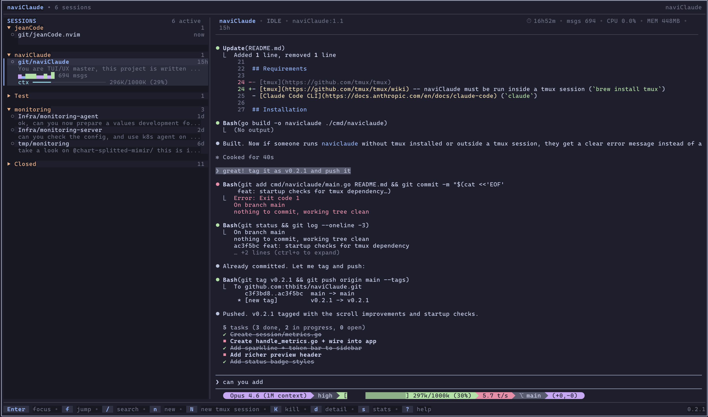

# naviClaude

TUI for managing Claude Code sessions across tmux sessions.

A "bring your own tmux" alternative to tools like [cmux](https://github.com/manaflow-ai/cmux) --
layers on top of your existing tmux setup instead of replacing it.



## Features

- **Session sidebar** -- lists active and recently closed Claude Code sessions, grouped by project
- **Live preview** -- real-time tmux pane capture of the selected session
- **Live activity line** -- under the selected session, what Claude is doing right now: the tool in flight, its target and the turn time (`⚙ Bash · go test ./... · 42s`), what it is waiting on you for (`needs approval: Edit`, `question: ...`, `plan approval`), or `✓ done 5m ago`, plus any running subagents (`⇉2 agents`) and background shells (`$1 shell`)
- **Context usage bar** -- current token usage vs the context window (`ctx ━━━──── 62K/1M (6%)`), amber from 60% and red above 85%; the window size is inferred from the model id (1M for Claude 5 models, Fable, Opus and `[1m]` variants, 200K otherwise, bumped if usage already exceeds it)
- **Branch and changes line** -- the session's git branch and its edited files at a glance (`⎇ main · 3 files +120/−8`)
- **Breathing status dots** -- active sessions pulse green, waiting sessions pulse amber, a blue `◉` marks a session that finished while you were away
- **Attention alerts** -- a sound and a colored bell / check after the tmux window name when Claude needs you or finishes, even while naviClaude is closed (see [Notifications](#notifications))
- **Passthrough mode** -- type directly into a session without leaving the TUI
- **Changed-files sidebar** -- a right-hand panel listing the files the selected session edited, with per-file `+/-` counts (live `git diff` while uncommitted, a persistent transcript estimate afterwards); open any file in your editor
- **Fuzzy search** -- filter sessions by name
- **Session management** -- create new sessions, kill existing ones, and resume closed sessions into any tmux session (or a brand-new one) via a target picker
- **Detail popup** -- view session metadata (project, CWD, branch, session ID, tmux target, model, Claude Code version, start time / uptime, message count, CPU/memory)
- **Rich preview header** -- status badge (including what a waiting session waits for), uptime, model (e.g. `Opus 5.5`), CPU/memory
- **Status title bar** -- one row with live counts of sessions working / needing you / done / idle; the footer shows a few hints for the current mode and `? more` opens the full key list
- **Attention-first ordering** -- sessions waiting on you, and their groups, always sort to the top
- **Usage statistics** -- rebuilt from your Claude Code transcripts: sessions, prompts, output and total tokens (each API response counted once; cache reads/writes and subagents included), top projects, prompts per day (per hour for Today), model share and busiest hour, filtered by All time / This week / Today. It only covers transcripts Claude Code still keeps on disk; per-file summaries are cached in `naviclaude/transcript-stats.gob` under your user cache dir (`~/Library/Caches` on macOS) so reopening it is fast
- **10 built-in color themes** with a live theme picker
- **Configurable key bindings** and layout options
- **Auto-collapse** -- idle project groups collapse automatically

## Requirements

- [tmux](https://github.com/tmux/tmux/wiki) 3.2 or newer -- naviClaude must be run inside a tmux session (`brew install tmux`). **tmux 3.8+ is recommended**: 3.7.x redraws popup borders on every status line or pane title redraw, so a popup blinks while Claude works, and 3.8 adds the floating panes naviClaude opens in (see [below](#run-as-a-floating-pane-tmux-38-recommended))
- [Claude Code CLI](https://docs.anthropic.com/en/docs/claude-code) (`claude`)

## Installation

### Homebrew

```
brew install thbits/tap/naviclaude
```

### Manual

```
git clone https://github.com/thbits/naviClaude.git
cd naviClaude
make install
```

This installs the binary to `~/.local/bin/naviclaude`. Set a custom prefix with `PREFIX=/usr/local make install`.

### Run as a floating pane (tmux 3.8+, recommended)

`naviclaude open` opens the dashboard over the current window: a **modal floating pane** on tmux 3.8 and newer, a `display-popup` on older tmux, so one binding works on every version. Add this to `~/.config/tmux/tmux.conf` to open it with `<prefix> g`:

```tmux
bind g run-shell -b 'naviclaude open -c "#{client_name}" -t "#{pane_id}"'
```

- `-b` runs the launcher in the background; `-c` / `-t` tell it which client and pane the key was pressed in (a `run-shell` job has neither of its own).
- `run-shell` uses the tmux server's `PATH`. If `naviclaude` is not on it, use the full path, e.g. `~/.local/bin/naviclaude open ...`.
- The pane is centered and sized by `popup_width` / `popup_height` (default 85% x 85% of the window).
- Pressing `<prefix> g` again while it is open does nothing. If the window already has some other modal pane, the launcher says so in the status line instead.
- Quit with `q`; jumping to a session (`f`) switches to it and closes naviClaude.
- Clicks outside the floating pane are ignored rather than closing it, `Esc` stays a naviClaude key, and the tmux prefix still works while it is open.
- Mouse support (click, wheel, menus) needs `set -g mouse on`.
- `naviclaude open -popup` forces the `display-popup` behaviour on tmux 3.8 too.

### Run as a tmux popup

`naviclaude open` already falls back to a popup on tmux 3.7 and older, so the binding above works as is. If you prefer a plain popup binding:

```tmux
bind g display-popup -E -w 85% -h 85% -x C -y C "naviclaude"
```

This binding sets its own size; `popup_width` / `popup_height` only apply to `naviclaude open`. tmux 3.8 gives popups a grey theme by default; naviClaude resets its own popup to your terminal's colours (when a single client is attached to the session), so no tmux.conf change is needed. You can also just run `naviclaude` in any tmux window or pane.

## Usage

Launch naviClaude from any terminal inside tmux:

```
naviclaude
```

Other commands:

```sh
naviclaude open [-c client] [-t pane] [-popup]   # open over the current window (floating pane or popup)
naviclaude hooks install | status | uninstall    # attention alerts (see Notifications)
naviclaude sound request | done                  # preview the alert sounds
naviclaude --version
```

The title bar shows live counts (`● 2 working · ◎ 1 needs you · ◉ 1 done · ○ 3 idle`) and the current tmux session. The footer lists only the most useful keys for the current mode; `? more` opens the help overlay with everything.

### Key bindings

| Key | Action |
|---|---|
| `j` / `k` | Navigate sessions |
| `Tab` / `Shift+Tab` | Cycle focus across the visible panes (session list -> preview passthrough -> changed files) |
| `Ctrl+]` | Exit passthrough straight to the session list |
| `Ctrl+U` / `Ctrl+D` | Scroll preview |
| `/` | Search |
| `Enter` | Focus an active session (passthrough mode); on a closed session, open the resume picker |
| `f` | Jump to pane. On a closed session, fast-resume into the current tmux session |
| `Ctrl+F` | Jump to pane (from passthrough) |
| `n` | New session (same tmux session) |
| `N` | New tmux session (prompts for name) |
| `r` | Rename session |
| `K` | Kill session |
| `F` | Open the changed-files sidebar and focus it; inside it, `F` closes it again (`Esc` drops focus but keeps it open) |
| `j` / `k` | In the changed-files sidebar, navigate files |
| `e` / `Enter` | In the changed-files sidebar, open the selected file in your editor |
| `d` | Detail popup |
| `s` | Statistics popup (`Tab` cycles All time / This week / Today, any other key closes) |
| `T` | Theme picker |
| `?` | Help overlay |
| `q` | Quit |

All key bindings except navigation and passthrough exit keys are configurable.

### Mouse

| Action | Effect |
|---|---|
| Click a session | Select it (and focus the session list) |
| Double-click a session | Same as `Enter`: focus an active session, open the resume picker for a closed one |
| Click a group header | Collapse / expand the group |
| Right-click a session | Open the context menu for that session |
| Long-press a session (hold ~450ms) | Open the context menu -- for tmux setups whose `MouseDown3Pane` binding swallows right-click |
| Wheel over the session list | Move the selection up / down |
| Wheel over the preview / changed files | Scroll them |
| Click the preview / changed files | Focus that pane (the preview only for a live session) |
| Click a hint in the bottom bar | Run that key |
| Click a menu item / picker row | Run it / select it (click the selected row again to confirm) |
| Click a filter tab in the statistics popup | Switch to that filter |
| Click outside a popup or menu | Close it |

Mouse events only reach naviClaude when tmux has `set -g mouse on`.

## Configuration

Config file location: `~/.config/naviclaude/config.yaml`

naviClaude creates this file automatically when you save a theme. All fields are optional -- missing fields use defaults.

```yaml
keys:
  quit: "q"
  search: "/"
  focus: "enter"
  jump: "f"
  new_session: "n"
  new_tmux_session: "N"
  kill_session: "K"
  rename_session: "r"
  detail: "d"
  stats: "s"
  toggle_changed: "F"
  help: "?"

sidebar_width: 30
refresh_interval: "200ms"
closed_session_hours: 8
group_sort_order: "name"
session_sort_order: "name"
popup_width: 85
popup_height: 85
resume_in_current_session: true
process_names: ["claude"]
collapse_after_hours: 8
active_window_secs: 5
cpu_active_threshold: 5
theme: "tokyo-night"
claude_command: "claude"
window_name: "{project}"
check_for_updates: true
focus_last_session: true
remember_group_state: true
# editor: "cursor"   # falls back to $EDITOR, then vi
# new_session_dir: "~/projects"
```

| Option | Default | Description |
|---|---|---|
| `sidebar_width` | `30` | Width of the session list panel |
| `refresh_interval` | `200ms` | How often to refresh session data |
| `closed_session_hours` | `8` | Show closed sessions from the last N hours |
| `group_sort_order` | `name` | Sort tmux session groups: `name` (alphabetical) or `activity`. Groups with a session waiting on you always come first |
| `session_sort_order` | `name` | Sort sessions within groups: `name` (alphabetical) or `activity`. Sessions waiting on you always come first |
| `popup_width` | `85` | Width of the `naviclaude open` floating pane or popup (percentage of the window) |
| `popup_height` | `85` | Height of the `naviclaude open` floating pane or popup (percentage of the window) |
| `resume_in_current_session` | `true` | Resume sessions in the current tmux pane |
| `process_names` | `["claude"]` | Process names to detect as Claude sessions |
| `collapse_after_hours` | `8` | Auto-collapse groups idle longer than N hours (0 to disable) |
| `active_window_secs` | `5` | Seconds after last transcript write to keep a session "working" (fallback signal) |
| `cpu_active_threshold` | `5` | Process-subtree CPU% above which a session counts as "working" |
| `theme` | `tokyo-night` | Color theme name |
| `claude_command` | `claude` | Command to start Claude (sent via send-keys, supports aliases) |
| `window_name` | `{project}` | tmux window name for sessions naviClaude creates or resumes; `{project}` (directory name) and `{harness}` expand, e.g. `"{harness}: {project}"`. The name is locked (`allow-rename off`) so your shell's title escapes cannot turn it into `cd` |
| `check_for_updates` | `true` | Check GitHub on startup for a newer release and show "update available" in the status bar |
| `focus_last_session` | `true` | On startup, re-focus the session you last had selected; falls back to the first session if it no longer exists |
| `remember_group_state` | `true` | On startup, restore the open/closed state of groups you manually toggled |
| `editor` | `$EDITOR`, else `vi` | Editor for opening changed files from the changed-files sidebar; may include flags. GUI editors (`cursor`, `code`, `zed`, ...) open in their own window; terminal editors (`vim`, `nvim`, `nano`, ...) take over the TUI and return on exit |
| `new_session_dir` | `~` | Working directory for new tmux sessions created with `N` |

## Notifications

naviClaude can ring a bell and mark the tmux window when a Claude session needs you. It works through Claude Code hooks, so it fires whether or not the dashboard is open:

```sh
naviclaude hooks install    # adds async hooks to ~/.claude/settings.json (backup in ~/Library/Caches/naviclaude)
naviclaude hooks status
naviclaude hooks uninstall
```

Restart running Claude sessions afterwards; hooks are read at session start. The hooks call this binary by absolute path, so re-run `install` if you move it.

| Event | What happens |
|---|---|
| Permission prompt, question (`AskUserQuestion`), plan approval, MCP input | **request** sound, a yellow bell `` is appended to the window name -- the marker clears as soon as Claude stops waiting (answered, Esc, ...) or you switch to the pane |
| Turn finished in a pane you are not looking at | **done** sound, a green check `` is appended until you visit it or send the next prompt |
| Turn finished while you are looking at it | nothing (unless `done_sound_when_focused`) |
| Prompt submitted | a blue spinner `` is appended while Claude works, even in the pane you are looking at; the bell and check take precedence over it |

Hooks are only triggers: before ringing, naviClaude confirms the state with Claude's own status file (`~/.claude/sessions/<pid>.json`), so prompts that auto mode approves instantly stay silent and the marker never sticks. Sounds respect a global cooldown so several sessions finishing together ring once. Outside tmux the hooks do nothing.

The default sounds are herdr's (Apache-2.0). Preview them with `naviclaude sound request` / `naviclaude sound done`. To customize:

```yaml
notifications:
  enabled: true
  request_sound: ""                # "" = built-in, a file path (mp3/aiff/wav), or "none"
  done_sound: "/System/Library/Sounds/Glass.aiff"
  done_sound_when_focused: false
  volume: 1                        # 0-1
  cooldown: "2s"
  window_marker: true
  waiting_marker: "#[fg=yellow,bold]#[nobold]"   # nf-fa-bell; any text, tmux #[...] styles allowed
  done_marker: "#[fg=green,bold]#[nobold]"      # nf-fa-check
  busy_marker: "#[fg=blue,bold]#[nobold]"       # nf-fa-spinner; "none" hides it
```

The markers need a [Nerd Font](https://www.nerdfonts.com/); swap in plain text such as `!` / `+` if you do not use one. The marker is a suffix, so your `window-status-format` colors after `#W` stay intact; the original name and its `automatic-rename` setting are restored when it clears. If you rename the window while it is marked, your new name is kept. To debug, `touch ~/Library/Caches/naviclaude/hook.log` and watch it.

## Themes

Available built-in themes:

- `catppuccin-latte`
- `catppuccin-mocha`
- `dracula`
- `gruvbox`
- `kanagawa`
- `nord`
- `one-dark`
- `rose-pine`
- `solarized-dark`
- `tokyo-night` (default)

Press `T` to open the theme picker with live color swatches. Selected themes are saved to the config file.

## License

MIT
